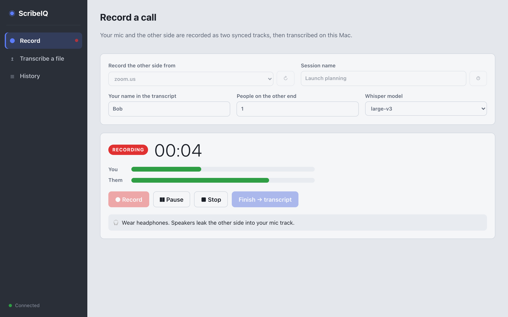
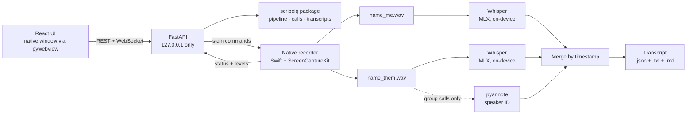
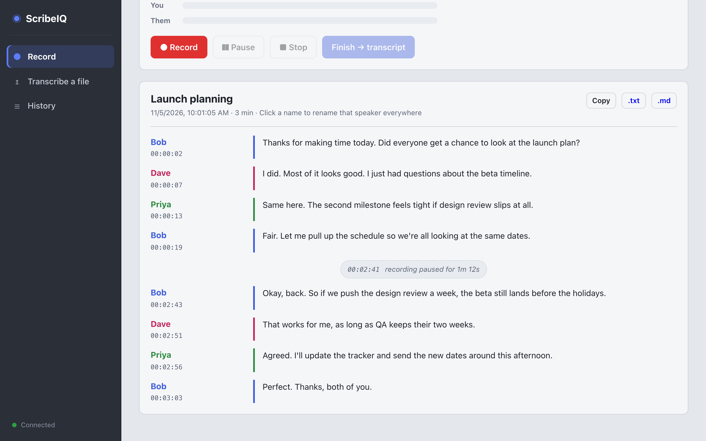
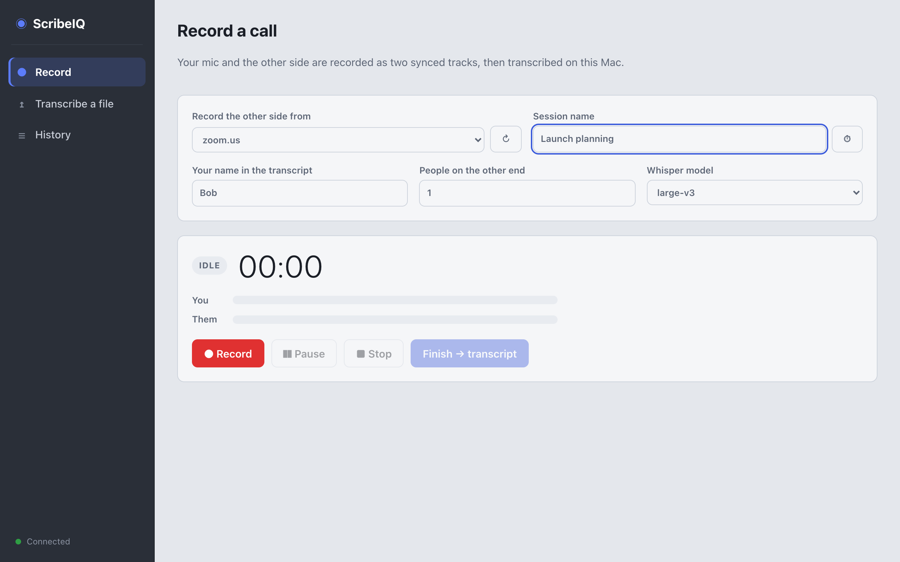
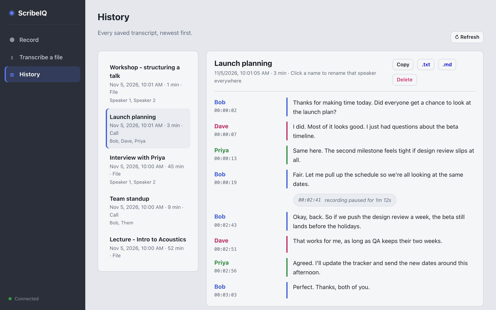
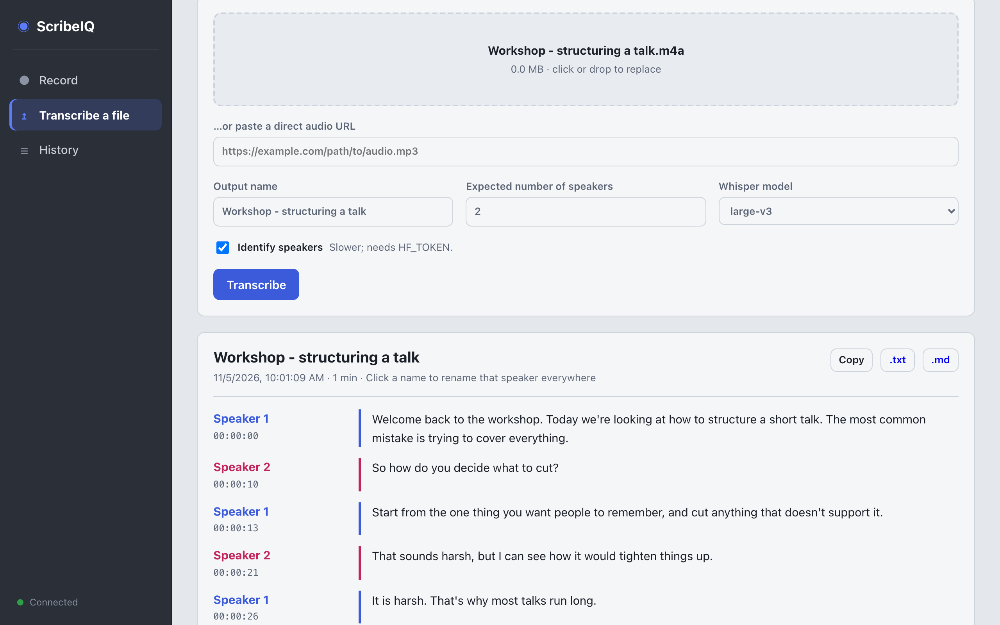

# ScribeIQ

Record a call from Zoom, a browser, or any other app and get a speaker-labeled transcript, entirely on your Mac. No cloud services, no subscriptions, no audio leaving your machine.



The saved transcript reads like this:

```text
[00:00:02] Me:
Thanks for making time today. Did you get a chance to look at the draft?

[00:00:06] Dave:
I did. Most of it looks good, I just had questions about the timeline.

[00:02:41] (recording paused for 1m 12s)

[00:02:43] Me:
Okay, back. So for the timeline...
```

## How it works

Most transcription tools record one mixed audio stream and then guess who said what. ScribeIQ records **your microphone and the call as two separate, synced tracks**, so it always knows which words are yours. Speaker identification only runs on the other side of the call, and only when more than one person is on it.



- **Interface:** a React + TypeScript front end (built with Vite) in its own native window. It talks to a local FastAPI server that wraps the `scribeiq` package: REST for actions, and a WebSocket that pushes the timer, level meters, and job progress five times a second. The server owns the recording state machine, so the buttons are enabled by the server, not by rules duplicated in the browser.
- **Capture:** a small Swift helper uses Apple's ScreenCaptureKit to record the mic and one chosen app's audio (or all system audio) in one stream, so both tracks share a clock. No BlackHole or virtual audio devices. Gaps are filled with silence so the two files stay aligned sample-for-sample.
- **Control:** the server runs the helper as a subprocess and talks to it over stdin/stdout (`pause`, `resume`, `stop` / `READY`, `LEVEL`, `SAVED`). If the app crashes, the helper sees its input close, saves, and exits, so it can never keep recording in the background.
- **Transcription:** [MLX Whisper](https://github.com/ml-explore/mlx-examples/tree/main/whisper) `large-v3`, Metal-accelerated on Apple Silicon. Each call track is mostly silence, so long silent stretches are skipped to stop Whisper from inventing text.
- **Speakers:** [pyannote.audio](https://github.com/pyannote/pyannote-audio) splits the other side into Speaker 1, Speaker 2, … for group calls. Click a name in the transcript to rename that speaker everywhere.
- **Storage:** each transcript is saved as `.json` (the source of truth) plus `.txt` and `.md` copies regenerated from it, so renames and the History list work on transcripts from earlier sessions too.

It also transcribes ordinary audio files or links, with optional speaker labels.

## Screenshots

**A finished call.** Each speaker gets a color; click a name to rename that person everywhere, including the saved files. Pauses are marked where they happened.



**Before recording.** Pick the app the call is in (Zoom, a browser, Teams…) or all system audio.



**History.** Every transcript, newest first, ready to reopen, rename, download, or delete.



**Transcribe a file.** Drop in an audio file or paste a link, with optional speaker labels.



## Features

- Record the other side from any running app (Zoom, Teams, a browser running Google Meet, …) or all system audio
- Record, pause, resume, and stop a call; both tracks stay in sync across pauses
- Live level meters for your mic and the call, so you know both are coming through
- Pauses are marked in the transcript
- Click a speaker's name to rename them everywhere, including the saved files
- History of every transcript: reopen, rename, download, or delete (deleted files go to the Trash)
- Light and dark mode, following the system
- One-on-one calls need no account or token at all
- Transcripts saved as plain text and Markdown (plus JSON), never overwriting earlier ones
- File and URL transcription, from the UI or the command line

## Requirements

- Apple Silicon Mac, macOS 15 or later (developed on macOS 27, M2, 24 GB)
- Python 3.12+ and [ffmpeg](https://ffmpeg.org/) (`brew install ffmpeg`)
- [Node.js](https://nodejs.org/) 20+ to build the interface (`brew install node`)
- Xcode command line tools, to build the recorder (`xcode-select --install`)
- About 10 GB free for the `large-v3` model (or use `turbo`, about 1.6 GB)

## Setup

```bash
git clone https://github.com/BobbyJoeCool/ScribeIQ.git
cd ScribeIQ
python3 -m venv .venv
source .venv/bin/activate
pip install -r requirements.txt
./recorder/build.sh
(cd frontend && npm install && npm run build)
cp .env.example .env
```

The built interface (`frontend/dist`) isn't committed: it's generated output, and keeping it out of git keeps the history readable. The trade-off is that Node is needed once, to build it. `python app.py` tells you if the build is missing.

### Hugging Face token (only for group calls and multi-speaker files)

1. Create a free account at <https://huggingface.co/join>.
2. Accept the model terms at <https://huggingface.co/pyannote/speaker-diarization-3.1>.
3. Create a read token at <https://huggingface.co/settings/tokens>.
4. Put it in `.env` as `HF_TOKEN=hf_...`.

### macOS permissions

The first time you record, macOS asks for **Screen & System Audio Recording** (needed to capture call audio) and **Microphone** access. These are granted to the app you launch ScribeIQ from, such as Terminal or VS Code. Listing running apps for the picker needs no permission. After allowing Screen Recording, quit and reopen that app.

## Usage

```bash
source .venv/bin/activate
python app.py              # opens the ScribeIQ window
python app.py --browser    # or use your default browser instead
```

**Record a call**

1. Put on headphones. Without them, the other side plays through your speakers into your mic track.
2. Start the call. In **Record the other side from**, pick the app the call is in (it defaults to Zoom when Zoom is running), or **All system audio**. Click ↻ if you opened the app after ScribeIQ.
3. Click **Record** and check that both level meters move.
4. Use **Pause** / **Resume** as needed, and **Stop** when the call ends. Stop saves the two tracks to `Outputs/recordings`.
5. Set how many people were on the other end, then click **Finish**. Expect a few minutes per hour of audio.
6. Click a speaker's name to rename them (`Speaker 1` → `Dave`). Transcripts are saved to `Outputs/transcripts`.

Closing the window while recording or transcribing asks first. A recording in progress is saved before ScribeIQ quits.

**Transcribe a file:** drop an audio file on the **Transcribe a file** tab, or paste a direct link to one. Or use the command line:

```bash
python transcribe.py interview.m4a --speakers 2
python transcribe.py --me call_me.wav --them call_them.wav --their-count 3
```

**History** lists every transcript, newest first, including ones made from the command line. Delete moves a transcript's files to the macOS Trash.

**Where files go:** everything is saved in `Outputs/` inside the project folder, so it's right there in your editor: `Outputs/recordings` for the audio tracks and `Outputs/transcripts` for transcripts. `Outputs/` is gitignored, so recordings and transcripts never get committed. To save somewhere else, set `SCRIBEIQ_HOME` in `.env`.

## Development

Run the API and the Vite dev server (with hot reload) in two terminals:

```bash
python app.py --dev            # API on 127.0.0.1:8765, opens a window on the dev UI
cd frontend && npm run dev     # UI on localhost:5173, forwards /api to the API
```

Add `--browser` to the first command to use a browser tab instead of a window. After changing the front end, run `npm run build` so `python app.py` serves the new version.

The server only listens on 127.0.0.1 and refuses requests from other web pages (it checks the `Host` and `Origin` headers), so a site open in your browser can't start or stop a recording.

## Tests

```bash
python -m unittest discover tests     # Python: core, recorder protocol, and API
cd frontend && npm test               # front end: buttons and transcript view
```

The Python tests cover track merging, the recording state machine, the Python ↔ recorder protocol, and every API endpoint. They use a fake recorder and stubbed transcription, so no audio, permissions, or models are needed. The front-end tests use Vitest and Testing Library.

## Project layout

```text
app.py                    Launcher: local server + native window (or --browser / --dev)
transcribe.py             Command line
scribeiq/api.py           FastAPI server: session, jobs, transcripts, live WebSocket
scribeiq/pipeline.py      Audio prep, Whisper, pyannote, formatting
scribeiq/calls.py         Two-track call transcription and merging
scribeiq/transcripts.py   Saved transcripts (.json + .txt + .md): list, rename, delete
scribeiq/recorder.py      Controls the recorder helper; recording state machine
scribeiq/config.py        Paths and .env settings
recorder/                 Swift recorder helper (ScreenCaptureKit)
frontend/                 React + TypeScript interface (Vite, CSS Modules)
tests/                    Python unit and API tests
docs/screenshots/         README images
Outputs/                  Your recordings and transcripts (gitignored)
```

Styling uses plain CSS Modules: Vite supports them out of the box, so there's no extra dependency, and each component's styles stay scoped to it.

## Limitations

- macOS only, and it relies on ScreenCaptureKit's microphone capture (macOS 15+).
- Transcription runs after the call, not live.
- Speaker labels on the other side can slip during fast back-and-forth or overlapping speech. Your own lines stay correctly labeled as long as you wear headphones.

## Recording consent

Laws on recording calls vary, and some places require everyone's consent. Let people know before you record.
